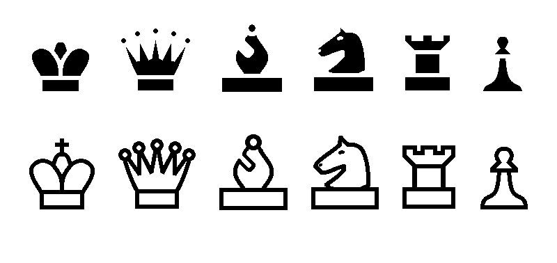

# 3D Chess (4×4×4)

A two-player chess variant played on four stacked 4×4 boards, written in Python with
[pygame](https://www.pygame.org/). It started as a university homework project ("Nagyházi").



## Running

```bash
pip install -r requirements.txt
python main.py
```

Needs Python 3.8+ and pygame 2.5+.

## Playing in the browser

This branch (`web-version`) also runs in the browser. [pygbag](https://github.com/pygame-web/pygbag)
compiles CPython and pygame to WebAssembly, so the same Python code runs unchanged in the page.

- Every push to `web-version` runs `.github/workflows/pages.yml`, which builds the game with pygbag
  and publishes the result to the `gh-pages` branch.
- Turn it on once in **Settings → Pages → Build and deployment**: Source **Deploy from a branch**,
  branch **gh-pages**, folder **/ (root)**.
- The game is then at `https://<user>.github.io/3d-chess/`.

To build and test locally:

```bash
pip install pygbag
python -m pygbag .
```

Then open http://localhost:8000. In the browser the game is saved to `localStorage` after every move,
together with whose turn it is.

Web-specific changes compared to `main`:

- The game loop is `async` and yields to the browser every frame (`await asyncio.sleep(0)`),
  which pygbag requires.
- Board squares are filled with `pygame.draw.polygon` instead of a pixel-by-pixel flood fill. The
  result is pixel-identical and it's much faster, which matters in WebAssembly.
- Saving uses `localStorage` in the browser, since there's no window-close event and the virtual
  file system is wiped on reload.

## How to play

- White moves first. Players take turns.
- Click one of your pieces to select it. The squares it can move to light up red,
  and the selected piece lights up green.
- Click a highlighted square to move there. Click anywhere else to cancel the selection.
- Moves that would leave your own king in check aren't allowed.
- The button in the top-right corner starts a new game.
- The game is saved to `mentes.txt` when you close the window and loaded on the next start.

## Files

| File | What it does |
| --- | --- |
| `main.py` | Entry point |
| `fuggvenyek.py` | Drawing, mouse input and the main game loop |
| `osztalyok.py` | `Babu` (piece) and `Palya` (board) classes, movement rules |
| `fajlkezeles.py` | Saving and loading the game |
| `Kepek/` | Piece images |
| `Extra/` | Original user and developer documentation (Hungarian) |
